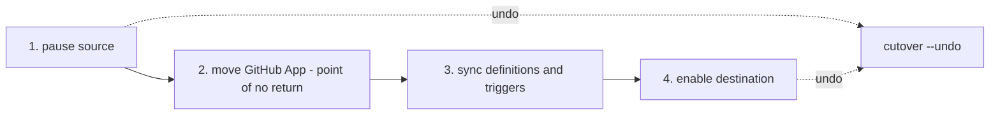

# Cutover

`cutover` switches builds from the source org to the destination, and you can undo it. It pauses the source, then enables the destination, and records every change in a state file so `--undo` can put it all back.

Without it, you would enable the destination with `sync --yes` and leave both orgs building. Use `cutover` whenever the source is still live.



Step 2 applies only to OAuth to GitHub App. After the GitHub App leaves the source org, `--undo` cannot bring back the source's App triggers.

## The flags

`cutover` is a dry run until you add `--apply`. Each item prints with its outcome, and the command exits non-zero if any item fails. Re-running is safe.

| Flag | What it does |
|---|---|
| `--pause-source` | On each source OAuth project, sets `drop-all-build-requests=true` (the old value is recorded) and disables the source triggers that are enabled and are not `github_oauth` triggers. Never unfollows a project. |
| `--pause-org` | Also sets `drop-all-build-requests` on the whole source org. Use with `--pause-source`. |
| `--enable-dest` | Enables each destination trigger whose source trigger was enabled. A trigger disabled in the source stays disabled. |
| `--undo` | Restores everything in the state file: source flags, source triggers, and destination triggers it enabled. |
| `--state` | State file path. Default `cutover-state.json`, mode 0600. |
| `--manifest`, `--mapping` | Needed for pause and enable. With `--undo` they only check that the state file matches your orgs. |

`--enable-dest` matches triggers by name, then by their fields. An ambiguous match, and a project the manifest shows as paused or not followed, is reported `manual` and left disabled. Enable that trigger by hand in **Project Settings > Triggers**. Run `sync --apply` first so the destination triggers exist.

If a pause fails in the same run, nothing is enabled.

## Order for OAuth to GitHub App

The order is fixed. Secrets transfer needs a source that can still build, and the source's App triggers vanish when the App is uninstalled. The full steps are in the [runbook](../migrations/oauth-to-app.md).

1. Freeze merges in the source repos.
2. `sync --skip-pipelines --apply` to create the destination projects.
3. `secrets transfer ... --apply` while the source can still build.
4. `cutover --pause-source --apply`.
5. Move the GitHub App: uninstall it from the source org, install it from the destination org.
6. `sync --apply --webhook-secrets-out webhook-secrets.json` to add definitions and triggers. Answer **N** at the enable prompt.
7. `cutover --enable-dest --apply`.
8. `validate`, then a smoke push.

> [!CAUTION]
> Step 5 is the point of no return. Uninstalling the GitHub App deletes the source org's App pipelines and triggers. The export is the only record. Pause the source first.

## Order for App to App

The destination projects, definitions and triggers already exist after `sync --apply`, so one step does the switch:

```bash
circleci-migrate cutover --manifest manifest.json --mapping mapping.json --pause-source --enable-dest
circleci-migrate cutover --manifest manifest.json --mapping mapping.json --pause-source --enable-dest --apply
```

Check: every item prints `set` or `exists`, and the exit code is 0.

## Order for OAuth to OAuth

`--enable-dest` acts on triggers, so it does nothing for an OAuth destination. An OAuth destination goes live when its projects are followed, which is the enable-builds prompt of `sync --apply`. Once the destination is validated, pause the source:

```bash
circleci-migrate cutover --manifest manifest.json --pause-source --apply
```

Add `--pause-org` to pause the whole source org.

## Undo

```bash
circleci-migrate cutover --undo --apply
```

Check: the source flags and triggers are back, and the destination triggers it enabled are disabled again.

`--undo` needs only the state file. It is safe to repeat and fails if the file is missing or belongs to another org. A state record is kept when a change fails in a way that may have applied it (a timeout or a 5xx).

| Can undo | Cannot undo |
|---|---|
| Source `drop-all-build-requests` flags. | Moving the GitHub App. A GitHub org connects to one CircleCI org at a time, so uninstall it from the new org and reinstall it on the old one yourself. |
| Source triggers that `cutover` disabled, while the App is still installed. | Source App triggers, once the App has been uninstalled. Only the flag comes back. |
| Destination triggers that `cutover` enabled. | Anything you changed outside `cutover`. |

## Keep these files safe

- `cutover-state.json`: without it `--undo` has nothing to restore from.
- `webhook-secrets.json`: holds the new webhook signing secrets and URLs, mode 0600, never printed. It is merged on re-runs, not overwritten.

Delete both once the cutover is confirmed and every sender and receiver has its new value.

## No live source

If nothing is building in the source, skip `cutover` and enable the destination directly with `sync --apply --yes`. On a re-run, add `--enable-existing-triggers` to enable triggers that already exist and are still disabled.

## After the cutover

- [ ] Do not build in both orgs. You would pay twice.
- [ ] Repoint what references the old org: service catalogs, badges, Slack and notification integrations, required status checks, and scripts with hard-coded project or context IDs.
- [ ] Rotate the secrets that moved and delete the `migration-secrets` context.
- [ ] Delete `cutover-state.json` once you are sure you will not undo.
- [ ] When the destination is healthy, decommission the source: unfollow its projects, archive its contexts, and tell your team and outside contributors.
