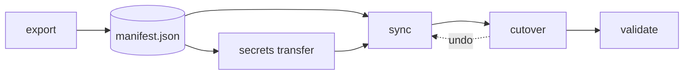

# How the migration works

A migration is five steps: export the source, move the secrets, sync the structure, cut over, validate. Each step is a `circleci-migrate` command, and every command that writes is a dry run until you add `--apply`.



The order of the middle steps changes with the migration type. Follow the runbook for yours: [OAuth to GitHub App](../migrations/oauth-to-app.md), [OAuth to OAuth](../migrations/oauth-to-oauth.md) or [App to App](../migrations/app-to-app.md).

## The five steps

| Step | Command | What it does |
|---|---|---|
| Export | `export` | Reads the source org and writes `manifest.json` and `migration-report.md`. Read-only. |
| Secrets | `secrets transfer` | Moves secret values from source to destination without writing them to disk. See [Secrets](secrets.md). |
| Sync | `sync` | Replays the manifest into the destination org. Dry run unless `--apply`. |
| Cutover | `cutover` | Pauses source builds and enables destination builds, reversibly. See [Cutover](cutover.md). |
| Validate | `validate` | Compares source and destination and exits 1 if anything is missing. |

`mapping.json` tells `sync` where the destination is. See [Mapping](mapping.md).

## The manifest

`manifest.json` is a snapshot of the source org: structure and names, never secret values. It is safe to read, diff and store.

The CircleCI API never returns a secret value, so the manifest lists variable names only. `migration-report.md` sits next to it. It lists everything captured and the manual follow-ups for your org. Read it before you sync.

Re-export whenever the source changes. Every later command reads the manifest, not the live source.

## Dry run first

`sync`, `secrets transfer`, `cutover` and `migrate` change nothing until you pass `--apply`. A dry run prints each action as one of these:

| Status | Meaning |
|---|---|
| `created (would create)` | `--apply` will create it. |
| `set (would set)` | `--apply` will write the value. |
| `exists` | Already there; reused. Re-runs are safe. |
| `manual` | The API cannot do it. The report says what to do by hand. |
| `error` | A problem. Fix it before you apply. |

New projects are created paused: no builds run in the destination until you enable them.

## Checks before you start

Run `doctor` first. It is read-only and checks tokens, org reachability, the `allow_api_trigger_with_config` setting and the GitHub token.

```bash
circleci-migrate doctor --source-org "$SOURCE_ORG" --dest-org "$DEST_ORG"
```

Check: it exits 0. Exit 1 means a hard failure, such as a missing token or an unreachable org. `export`, `sync` and `migrate` run the same checks on startup; `--skip-preflight` turns them off.

## Tokens and slugs

Use a personal API token for each side, from **User Settings > Personal API Tokens**. The token's user must be an organization admin of the org it acts on.

| Variable | Used for |
|---|---|
| `CIRCLECI_SOURCE_TOKEN` | Reading the source org. |
| `CIRCLECI_DEST_TOKEN` | Writing the destination org. |
| `CIRCLECI_CLI_TOKEN` or `CIRCLE_TOKEN` | Fallback for both sides. |
| `GITHUB_TOKEN` | Repo read. Needed for OAuth to App and for repos moving to a new GitHub org. |

The org slug decides which APIs the tool uses.

| Org type | Slug | Notes |
|---|---|---|
| GitHub OAuth | `gh/<org>` | Projects are followed to install webhooks. |
| Bitbucket OAuth | `bb/<org>` | Same as GitHub OAuth. |
| GitHub App, GitLab or standalone | `circleci/<org-id>` | Projects use pipeline definitions and triggers. Standalone orgs also carry roles and groups. |

> [!NOTE]
> One GitHub org can have both an OAuth record (`gh/acme`) and an App record (`circleci/<id>`). They are separate orgs. Migrate each one on its own.

For CircleCI Server, pass `--host https://circleci.example.com` (or set `CIRCLECI_CLI_HOST`). The default is `https://circleci.com`.

## What sync does

- **Order.** Contexts come before projects. A project-type context restriction needs its destination project, so the first run can report it `manual`. Re-run `sync --apply` to resolve it.
- **Re-runs.** A re-run creates only what is missing and reports the rest `exists`. A trigger you disabled on purpose is not re-enabled unless you pass `--enable-existing-triggers`.
- **Enabling builds.** After creating projects, `sync` asks whether to enable builds. `--yes` answers for you. Do not use `--yes` while the source is still building, or both orgs build. Use [cutover](cutover.md).
- **Danger flags.** `drop_all_build_requests` and `require_context_group_restriction` are skipped by default because they can freeze a new org. Add `--include-danger-flags` once the destination is validated.
- **Webhook secrets.** CircleCI never returns signing secrets. `--webhook-secrets-out webhook-secrets.json` writes new ones (mode 0600, never printed). Hand each sender and receiver its new value.
- **Project API tokens.** Recreated only with `--create-project-tokens`, and each one is a new value.
- **Scoping.** `--skip-org-settings`, `--skip-contexts`, `--skip-projects`, `--skip-pipelines`, `--skip-extras`, `--skip-runner`, `--skip-ciam` and `--skip-orb` leave a section alone.

## Orbs and runner classes

Orb namespaces and runner resource classes belong to one org, so they need extra steps.

- **Different destination namespace.** `sync --dest-orb-namespace` republishes every stable version. A notice lists each `old/orb` to `new/orb` reference to rewrite in your configs.
- **Same namespace name.** An orb namespace cannot exist in two orgs. Ask CircleCI support to move it to the destination org. The orbs move with it and configs need no change.
- **Runner classes.** `--runner-namespace` on export and `--dest-runner-namespace` on sync recreate class definitions only. Instances and tokens do not move. After a same-name namespace move, classes stay attributed to the source org. Delete the source copies, re-run `sync`, create new tokens and re-register agents.

## The all-in-one command

`migrate` runs export, sync and validate in one go. With no flags on a terminal it starts a guided walkthrough, then shows a dry run and asks before it applies.

```bash
circleci-migrate migrate --source-org "$SOURCE_ORG" --dest-org "$DEST_ORG" \
  --transfer-secrets --dest-token-context migration-secrets --include-project-vars
```

The walkthrough asks which components to migrate (contexts, projects, org settings, extras, orbs, runners) and how to move secrets. Check: it prints a summary with counts and a "Needs attention" list. Add `--apply` to write.

Use the step-by-step commands for production moves, especially OAuth to GitHub App. `migrate` cannot do the pause and App-move steps in the right order.

## The `circleci` CLI plugin

`circleci run migrate <args>` runs `circleci-migrate` and passes `CIRCLE_TOKEN` and `CIRCLE_URL` for you. Bare `circleci migrate` is not supported.
