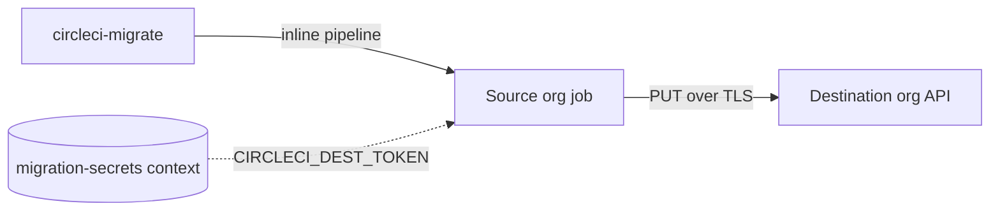

# Moving secret values

Use `secrets transfer` to move secret values. It sends them from the source org to the destination org without writing them to disk. Use `secrets capture` only when you need a local, reviewable bundle.

CircleCI never returns a secret value through its API. The only place a value can be read is inside a running pipeline of the org that owns it, so both methods run a short-lived pipeline in your source org.



## Transfer: the recommended method

The CLI submits one inline pipeline to the source org. Inside it, CircleCI injects the real values and the job writes each one straight to the destination. No value reaches your laptop, an artifact or storage.

The job needs a destination API token. Put it in a context in the source org and pass the context's name. The generated config references `${CIRCLECI_DEST_TOKEN}` and never contains the token.

```bash
# 1. In the SOURCE org, create a context named migration-secrets
#    holding CIRCLECI_DEST_TOKEN (a destination org-admin token).

# 2. Dry run: prints the plan, triggers nothing.
circleci-migrate secrets transfer --manifest manifest.json --mapping mapping.json \
  --dest-org-id "$DEST_ORG_ID" --dest-token-context migration-secrets \
  --include-project-vars --include-ssh-keys --remove-restrictions

# 3. Apply.
circleci-migrate secrets transfer --manifest manifest.json --mapping mapping.json \
  --dest-org-id "$DEST_ORG_ID" --dest-token-context migration-secrets \
  --include-project-vars --include-ssh-keys --remove-restrictions --enable-trigger --apply
```

Check: the plan lists each context and project with `[create]` or `[update]` and no `SKIP` lines. After `--apply`, the destination shows the same variable names.

> [!NOTE]
> Anyone who can create pipelines in the source org can read the token context. Use a token with the least access that works, and rotate it when the transfer is done.

### Key flags

| Flag | Use |
|---|---|
| `--dest-org-id` | Destination org UUID (**Organization Settings > Overview**). A slug is rejected. `--dest-org` also works and is resolved for you. |
| `--dest-token-context` | Name of the source-org context holding the destination token. |
| `--include-project-vars` | Also move project env vars. Needs the destination project to exist. |
| `--include-ssh-keys` | Also move additional project SSH keys. |
| `--remove-restrictions` | Lift project and expression restrictions on contexts for the run, then restore them. Group restrictions are never touched. |
| `--enable-trigger` | Turn on `allow_api_trigger_with_config` for the run and restore it afterwards. |
| `--skip-contexts` | Run only the per-project pipelines, for contexts already moved. |
| `--host-project` | Source project that runs the context pipeline. Defaults to a suitable one. |

### Rules that decide the order

- **Destination projects must exist** before you move project vars or SSH keys. Contexts are created for you. For a GitHub App destination, create the projects first with `sync --apply --skip-pipelines`.
- **Projects are matched by name.** For a GitHub App destination a source project with no `projects` entry in `mapping.json` is matched to the destination project of the same name. An entry always wins. A project that matches neither is shown as `SKIP`, and the run exits non-zero.
- **The source must still be able to build.** Run the transfer before `cutover --pause-source`. It fails fast and names any paused project.
- **`gh/` and `bb/` source projects need a way to check out.** CircleCI will not start a pipeline on them without a GitHub App pipeline definition or a checkout key. The CLI prefers an App definition and checks this before it changes anything.
- **Move secrets before the GitHub App leaves the source org.** After the uninstall the App definitions are gone, and every project then needs a checkout key.

Contexts with project or expression restrictions block the pipeline unless you pass `--remove-restrictions`. If a restore fails, the CLI prints the exact restriction to re-add.

## Capture: the local bundle

`secrets capture` runs the same kind of pipeline but writes the values to an encrypted artifact, downloads it and saves a local `secrets.json`. `sync --secrets secrets.json` then writes the values as it creates each resource.

```bash
circleci-migrate secrets capture --manifest manifest.json \
  --encrypt --generate-key --artifact-retention-days 1 --enable-trigger \
  --output secrets.json
```

Check: `secrets.json` exists with mode 0600. Capture before `sync`.

| Flag | Use |
|---|---|
| `--encrypt` | On by default. Encrypts the artifact with age so plaintext never sits in CircleCI. |
| `--generate-key` | Creates a fresh age keypair. Or pass `--ssh-public-key` and `--ssh-private-key`. |
| `--artifact-retention-days 1` | Shortens how long the artifact stays in CircleCI. |
| `--storage` | `artifact` (default), `s3` or `both`. S3 needs `--s3-bucket` and optionally `--s3-prefix`. |
| `--context`, `--project` | Limit what is captured. |
| `--ssh-keys=false` | Skip additional SSH keys, which are captured by default. |
| `--remove-restrictions` | Lift context restrictions for the run. By default restricted contexts are skipped. |
| `--yes` | Allow an unattended capture of everything. Without it, a non-interactive run with no `--context` or `--project` stops. |

Restricted contexts skipped at capture can still get their variable names: `sync --missing-secrets placeholder` creates each name with a placeholder value to fill in later.

`secrets decrypt` decrypts a bundle you downloaded yourself. For many contexts, the `awesomecicd/circleci-org-migration` orb runs one `extract_context` job per context, then a `merge` job. Use one context per job so same-named variables cannot overwrite each other.

> [!WARNING]
> Do not mix methods for the same resources. A bundle contains plaintext values. Keep it out of git, and delete it after the sync.

## After the move

- [ ] Rotate every value that moved. Treat each as exposed once it left the source.
- [ ] Delete the `migration-secrets` context from the source org, or rotate its token.
- [ ] Delete `secrets.json` and any decrypted copies, if you used capture.
- [ ] Spot-check the destination: variable names and counts match. Values stay masked, and `validate` compares names, not values.

## What does not move

| Item | Why | What to do |
|---|---|---|
| Checkout and deploy key private keys | No API returns them. | Add a deploy key in the destination. A GitHub App destination needs none. |
| Webhook signing secrets | The source values are unreadable. | `sync --webhook-secrets-out` generates new ones. |
| Project API token values | Shown once, at creation. | `sync --create-project-tokens` mints new values. Repoint consumers. |
| Restricted-context values | The pipeline cannot read them without `--remove-restrictions`. | Re-run with the flag, or fill in by hand. |
