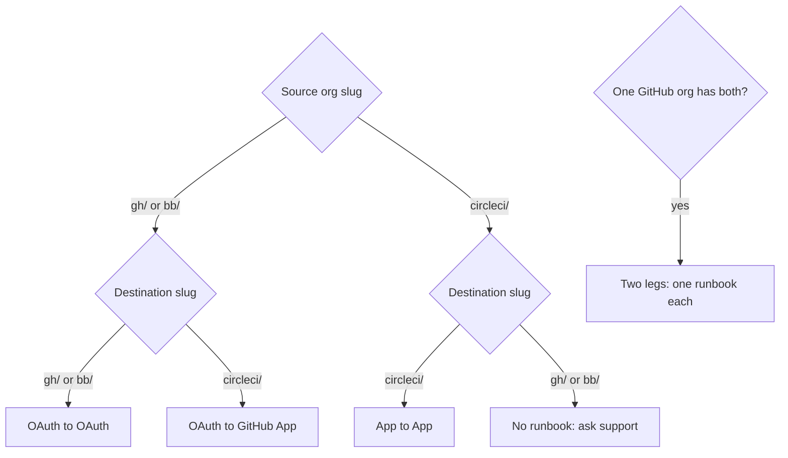

# Which migration am I doing?

Find your source org's slug (Organization Settings > Overview), then follow the arrows to a runbook. A slug starting with `gh/` or `bb/` is an OAuth org. A slug starting with `circleci/` is a GitHub App or standalone org.

If one GitHub org has both an OAuth record and an App record, CircleCI keeps them as two orgs. Migrate each as its own leg.

| Scenario | Runbook |
|---|---|
| Rename or consolidate GitHub OAuth orgs (`gh/` to `gh/`) | [OAuth to OAuth](../migrations/oauth-to-oauth.md) |
| Repos moved to a new GitHub org, OAuth on both sides | [OAuth to OAuth](../migrations/oauth-to-oauth.md) |
| Bitbucket OAuth to Bitbucket OAuth (`bb/` to `bb/`) | [OAuth to OAuth](../migrations/oauth-to-oauth.md) |
| Legacy OAuth org to a GitHub App org (`gh/` to `circleci/`) | [OAuth to GitHub App](../migrations/oauth-to-app.md) |
| GitHub App or standalone org to another (`circleci/` to `circleci/`) | [App to App](../migrations/app-to-app.md) |
| App org, repos moved to a new GitHub org | [App to App](../migrations/app-to-app.md) |
| Mixed org: OAuth record plus App record | One runbook per leg |

How long it takes depends on your org. Plan a freeze window long enough for the steps marked Cutover. A dry run against a test org tells you how long they take, because the secrets transfer runs one pipeline per project.

Not sure what is in your org? Run `circleci-migrate export --source-org <slug>` and read `migration-report.md`. It is read-only.

To get the commands filled in for your own org slugs, use the [plan builder](../../plan/) on the docs site. It runs in your browser and never asks for a token.

Next: [install the CLI](install.md), then see [what moves](what-moves.md).
