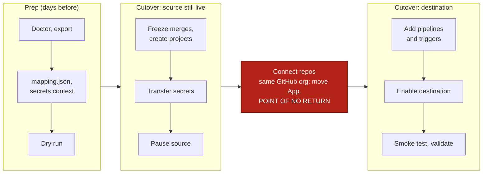

# GitHub App to GitHub App

Use this runbook to move one GitHub App or standalone org (`circleci/…`) to another (`circleci/…`): a consolidation, a split, or a move to a new GitHub org. Do the prep ahead of time, then run the cutover inside a freeze window.

## At a glance



If your repos move to a new GitHub org, step 9 uninstalls nothing and there is no point of no return.

## What moves

- Moves automatically: contexts, projects, project and org settings, pipeline definitions, triggers and schedules (created disabled), org roles and groups, runner resource classes.
- Needs a step: secret values and SSH keys, webhook secrets and URLs, orbs and runner instances (step 11).
- Does not move: per-project role grants, SSO, build history, and group context restrictions unless the group exists in the destination.

The full list is in [what moves](../get-started/what-moves.md).

## Before you start

- [ ] You are an admin of both CircleCI orgs, the destination org exists, and you have a personal API token for each (User Settings > Personal API Tokens).
- [ ] The CLI is installed ([install](../get-started/install.md)). `circleci-migrate version` prints v0.19.0 or later.
- [ ] Every user whose org role should move is already a member of the destination org. Roles apply only to existing members, matched by email. Pass `--skip-ciam` to `sync` to leave roles and groups alone.
- [ ] Repos moving to a new GitHub org: a GitHub token with `repo` read, and the CircleCI GitHub App installed in the new GitHub org from the destination CircleCI org.
- [ ] Same GitHub org: you can install and uninstall the CircleCI GitHub App in it. A GitHub org connects to one CircleCI org at a time.

## Set up

```bash
export SOURCE_ORG="circleci/<source-org-id>"
export DEST_ORG="circleci/<dest-org-id>"
export DEST_ORG_ID="<dest-org-uuid>"
export CIRCLECI_SOURCE_TOKEN="<source-org-admin-token>"
export CIRCLECI_DEST_TOKEN="<destination-org-admin-token>"
export GITHUB_TOKEN="<github-pat-with-repo-read>"   # only if repos move to a new GitHub org
```

```powershell
$SOURCE_ORG = "circleci/<source-org-id>"
$DEST_ORG = "circleci/<dest-org-id>"
$DEST_ORG_ID = "<dest-org-uuid>"
$env:CIRCLECI_SOURCE_TOKEN = "<source-org-admin-token>"
$env:CIRCLECI_DEST_TOKEN = "<destination-org-admin-token>"
$env:GITHUB_TOKEN = "<github-pat-with-repo-read>"   # only if repos move to a new GitHub org
```

Find an org ID under Organization Settings > Overview. Commands use `\` to continue lines. In PowerShell, end the line with a backtick instead.

## Steps

### Prep

#### 1. Run preflight

Catch bad tokens and unreachable orgs early. `doctor` is read-only.

```bash
circleci-migrate doctor --source-org "$SOURCE_ORG" --dest-org "$DEST_ORG"
```

Check: it exits 0 with no hard failures.

#### 2. Export the source

Export records names and structure, never secret values, and is read-only. Run it while the source still has its pipelines, so the definitions are captured.

```bash
circleci-migrate export --source-org "$SOURCE_ORG" --output manifest.json --report migration-report.md
```

Add `--runner-namespace <namespace>` for self-hosted runners and `--orb-namespace <namespace>` for orbs.

Check: read `migration-report.md` in full and note the counts of contexts, projects and project env vars.

#### 3. Write mapping.json

Without `org.to`, `sync` writes to your source org. The `org` line is all you need, because projects are matched by name.

```bash
cat > mapping.json <<EOF
{ "org": { "from": "$SOURCE_ORG", "to": "$DEST_ORG" } }
EOF
```

```powershell
@{ org = @{ from = $SOURCE_ORG; to = $DEST_ORG } } | ConvertTo-Json | Set-Content mapping.json
```

If the repos moved to a new GitHub org, add `"github_org": { "from": "acme", "to": "acme-new" }` and pass `--dest-github-org acme-new` to every `sync` below. See [mapping](../concepts/mapping.md).

Check: `mapping.json` has `org.to` set to the destination.

#### 4. Create the migration-secrets context

Secret values can only be read inside a pipeline. The transfer pipeline runs in the source org and gets the destination token from a context. In the source org, go to Organization Settings > Contexts and create `migration-secrets` with one variable, `CIRCLECI_DEST_TOKEN`, set to the destination token.

Check: the context exists in the source org with that one variable.

#### 5. Dry-run the cutover commands

Every command below is a dry run until you add `--apply`. Read each plan now.

```bash
circleci-migrate sync --manifest manifest.json --mapping mapping.json --skip-pipelines --skip-orb --skip-runner
circleci-migrate secrets transfer --manifest manifest.json --mapping mapping.json \
  --dest-org-id "$DEST_ORG_ID" --dest-token-context migration-secrets \
  --include-project-vars --include-ssh-keys --remove-restrictions
circleci-migrate cutover --manifest manifest.json --mapping mapping.json --pause-source
```

Check: no unexplained `error` lines. Every project shows `SKIP` in the transfer plan because the destination projects do not exist yet. That is expected.

### Cutover

#### 6. Freeze merges and create the destination projects

Stop merges in the source repos so nothing lands between the transfer and the switch. Then create the projects: project env vars are written into them, so they must exist first. This creates projects, contexts, settings, org roles and groups, but no pipelines or triggers.

```bash
circleci-migrate sync --manifest manifest.json --mapping mapping.json \
  --skip-pipelines --skip-orb --skip-runner --apply
```

Check: every project reports `skipped: --skip-pipelines`, and the team confirms the freeze. Re-run the step 5 transfer dry run: no project shows `SKIP` now.

#### 7. Transfer the secrets

This runs one pipeline per source project and writes each value straight to the destination over TLS. Nothing touches disk. It must run before you pause the source, because a paused project drops the pipeline. If your repos move to a new GitHub org, run it before they move, because the pipelines check out code from the old org.

```bash
circleci-migrate secrets transfer --manifest manifest.json --mapping mapping.json \
  --dest-org-id "$DEST_ORG_ID" --dest-token-context migration-secrets \
  --include-project-vars --include-ssh-keys --remove-restrictions \
  --enable-trigger --apply
```

Check: the log reports every context and project pipeline succeeded. See [secrets](../concepts/secrets.md).

#### 8. Pause the source

Pausing stops builds in the source and records every change in `cutover-state.json`, so you can undo it. Preview first.

```bash
circleci-migrate cutover --manifest manifest.json --mapping mapping.json --pause-source
circleci-migrate cutover --manifest manifest.json --mapping mapping.json --pause-source --apply
```

Check: every source project is listed as paused, and `cutover-state.json` exists. Keep it until the cutover is confirmed.

#### 9. Connect the repos to the destination

Definitions can only be created for repos the destination GitHub App can see.

- New GitHub org: confirm every repo is connected in the destination org's GitHub App installation. Nothing is uninstalled.
- Same GitHub org: uninstall the CircleCI GitHub App from the source org's connection, then install it from the destination org with every migrating repo selected. Users click Authorize, then Refresh permissions if Projects is empty.

> [!CAUTION]
> Same GitHub org only. Uninstalling deletes the source org's GitHub App pipelines and triggers, and the export is the only record of them. `cutover --undo` can no longer re-enable them.

Check: the destination org lists every repo as connected.

> [!TIP]
> New GitHub org only: if you created definitions and triggers earlier (a `sync --apply` without `--skip-pipelines`), the pause and the enable can run as one command: `cutover --pause-source --enable-dest --apply`. Run the transfer first.

#### 10. Add pipeline definitions and triggers

Triggers are created disabled. New webhook URLs and secrets go to `webhook-secrets.json` (mode 0600). Answer N at the "Enable N trigger(s)" prompt, because `cutover` enables them in step 12.

```bash
circleci-migrate sync --manifest manifest.json --mapping mapping.json \
  --skip-orb --skip-runner --apply --webhook-secrets-out webhook-secrets.json
```

Check: no line says "connect the repo to the GitHub App". If one does, connect the repo and re-run.

#### 11. Move orbs and runners (only if you use them)

A namespace belongs to one org. Ask CircleCI support to move a same-name namespace, and orb references need no change. For a different namespace, republish. Resource classes are recreated, but runner instances never move, so register agents with new tokens.

```bash
circleci-migrate sync --manifest manifest.json --mapping mapping.json \
  --only orb --dest-orb-namespace <new-namespace> --apply
circleci-migrate sync --manifest manifest.json --mapping mapping.json \
  --only runner --dest-runner-namespace <namespace> --apply
```

Check: runners show online, and `validate` lists the orbs (see Verify). Update cloud OIDC trust policies for the new org ID.

#### 12. Enable the destination

This enables only the triggers that were enabled in the source. Do not run `sync --apply --yes` here: it enables triggers without pausing the source, so both orgs build.

```bash
circleci-migrate cutover --manifest manifest.json --mapping mapping.json --enable-dest
circleci-migrate cutover --manifest manifest.json --mapping mapping.json --enable-dest --apply
```

Check: no project reports `manual`. If one does, enable that trigger in Project Settings > Triggers. See [cutover](../concepts/cutover.md).

## Verify

Push a commit to a migrated repo. Check: a pipeline starts in the destination org, runs green, and a job can read a context variable.

```bash
circleci-migrate validate --source-org "$SOURCE_ORG" --dest-org "$DEST_ORG" \
  --mapping mapping.json --dest-token-context migration-secrets
```

A clean report exits 0 and lists only expected `manual` items: SSO, role bindings and per-project grants. Add `--dest-runner-namespace` and `--dest-orb-namespace` to compare runners and orbs. Then clean up:

- [ ] Give each webhook sender and receiver its new value from `webhook-secrets.json`, then delete the file.
- [ ] Recreate per-project role grants in the destination.
- [ ] Rotate every transferred secret. Rotate the destination token and delete the `migration-secrets` context.
- [ ] Update badges, Slack apps and required status checks for the new project slugs.

## Roll back

Before the App moves in step 9, undo everything. This restores the source flags and triggers and disables the destination triggers it enabled.

```bash
circleci-migrate cutover --manifest manifest.json --mapping mapping.json --undo --apply
```

After a same-GitHub-org App move, `--undo` restores only the `drop-all-build-requests` flag. It does not move the App. To return, uninstall it from the destination org and reinstall it from the source.

## If your org is mixed (OAuth and App)

When one GitHub org has both integrations, CircleCI keeps two org records: `gh/<org>` and `circleci/<id>`. Migrate each as its own leg, with its own manifest, mapping and state file.

- OAuth leg: follow [OAuth to GitHub App](oauth-to-app.md), or [OAuth to OAuth](oauth-to-oauth.md) if the destination is OAuth.
- App leg: follow this runbook. Add `--skip-org-settings` to its `sync` commands if the first leg already wrote the org settings, and `--state cutover-state-app.json` to every `cutover` command.

## If something fails

| Error | Fix |
|---|---|
| Pipeline definition is `manual`: connect the repo | Connect the repo to the destination GitHub App and re-run `sync --apply`. |
| `source project(s) are paused` | Run the transfer before the pause, or run `cutover --undo --apply` and retry. |
| Org roles missing in the destination | The user is not yet a destination member. Add them, then re-run `sync --apply`. |
| Wrong repo IDs after a GitHub org move | Set `GITHUB_TOKEN` and pass `--dest-github-org` to `sync`. |

More in [troubleshooting](../reference/troubleshooting.md). Flags: [`sync`](../cli/circleci-migrate_sync.md), [`secrets transfer`](../cli/circleci-migrate_secrets_transfer.md), [`cutover`](../cli/circleci-migrate_cutover.md).
