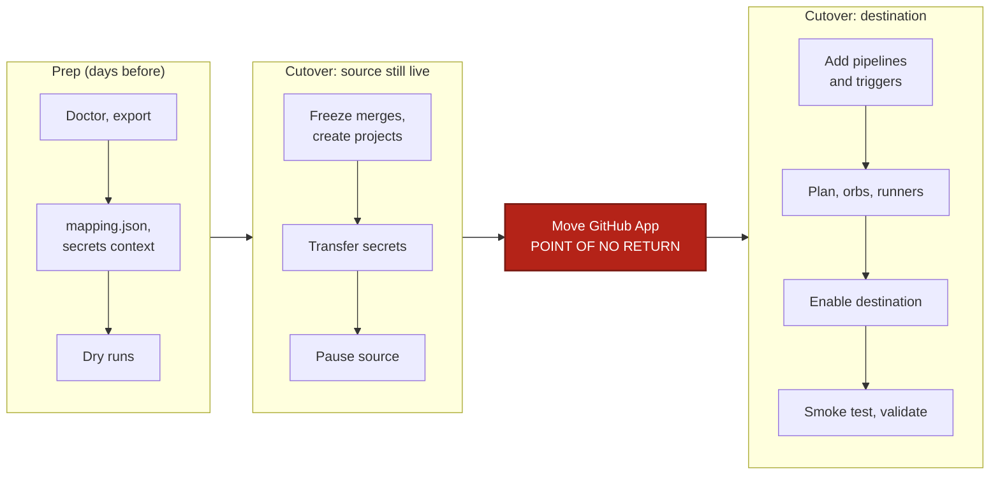

# GitHub OAuth to GitHub App

Use this runbook to move a GitHub OAuth org (`gh/…`) to a standalone GitHub App org (`circleci/…`). Do the prep ahead of time, including the support requests, then run the cutover inside a freeze window.

## At a glance



Order matters: move secrets while the source can still build, and pause the source before the App moves.

## What moves

- Moves automatically: contexts, projects, project and org settings, project and expression context restrictions, pipeline definitions and triggers (created disabled).
- Needs a step: secret values, webhook secrets and URLs, the plan and any orb namespace (CircleCI support).
- Not carried over: fork-PR builds, fork-PR secrets, the OSS flag and `pr_only_branch_overrides` have no App equivalent. Use trigger filters in the pipeline definition, and tell contributors.
- Group context restrictions resolve by group name if the group exists in the destination. Otherwise they become `manual`: use expression or project restrictions.
- Each OAuth project without an App definition gets one synthesized `build-and-test` definition. Add other config paths by hand. Trigger names are assigned by CircleCI, not copied.
- SSO, build history and Insights do not move.

The full list is in [what moves](../get-started/what-moves.md). This migration is lossy, so read it before you start.

## Before you start

- [ ] You are an admin of both CircleCI orgs and can install and uninstall the CircleCI GitHub App in the GitHub org.
- [ ] The destination org exists. You have its Organization ID (Organization Settings > Overview) and a personal API token for each org (User Settings > Personal API Tokens).
- [ ] A GitHub token with `repo` read. Any OAuth project without a captured GitHub App pipeline needs it to look up the repo ID, and preflight fails without it.
- [ ] The CLI is installed ([install](../get-started/install.md)). `circleci-migrate version` prints v0.19.0 or later.

## Set up

```bash
export SOURCE_ORG="gh/acme"
export DEST_ORG="circleci/<dest-org-id>"
export DEST_ORG_ID="<dest-org-uuid>"
export CIRCLECI_SOURCE_TOKEN="<source-org-admin-token>"
export CIRCLECI_DEST_TOKEN="<destination-org-admin-token>"
export GITHUB_TOKEN="<github-pat-with-repo-read>"
```

```powershell
$SOURCE_ORG = "gh/acme"
$DEST_ORG = "circleci/<dest-org-id>"
$DEST_ORG_ID = "<dest-org-uuid>"
$env:CIRCLECI_SOURCE_TOKEN = "<source-org-admin-token>"
$env:CIRCLECI_DEST_TOKEN = "<destination-org-admin-token>"
$env:GITHUB_TOKEN = "<github-pat-with-repo-read>"
```

Commands use `\` to continue lines. In PowerShell, end the line with a backtick instead.

## Steps

### Prep (days before the cutover)

#### 1. Run preflight

Catch bad tokens and unreachable orgs before you touch anything. `doctor` is read-only.

```bash
circleci-migrate doctor --source-org "$SOURCE_ORG" --dest-org "$DEST_ORG"
```

Check: it exits 0 with no hard failures.

#### 2. Export the source

Export records names and structure, never secret values, and is read-only. Run it while the GitHub App is still installed on the source, so existing App pipelines are captured.

```bash
circleci-migrate export --source-org "$SOURCE_ORG" --dest-org "$DEST_ORG" \
  --output manifest.json --report migration-report.md
```

If you use self-hosted runners or publish orbs, add `--runner-namespace <namespace>` and `--orb-namespace <namespace>`.

Check: read `migration-report.md` in full and note the counts of contexts, projects and project env vars.

#### 3. Write mapping.json

The mapping tells `sync` which org to write to. The `org` line is all you need, because App projects are matched by name.

```bash
cat > mapping.json <<EOF
{ "org": { "from": "$SOURCE_ORG", "to": "$DEST_ORG" } }
EOF
```

```powershell
@{ org = @{ from = $SOURCE_ORG; to = $DEST_ORG } } | ConvertTo-Json | Set-Content mapping.json
```

If the repos also move to a new GitHub org, add `"github_org": { "from": "acme", "to": "acme-new" }` to the file and pass `--dest-github-org acme-new` to every `sync` below. See [mapping](../concepts/mapping.md).

Check: `mapping.json` has `org.to` set to the destination.

#### 4. Create the migration-secrets context

Secret values can only be read inside a pipeline. The transfer pipeline runs in the source org and gets the destination token from a context. In the source org, go to Organization Settings > Contexts and create `migration-secrets` with one variable, `CIRCLECI_DEST_TOKEN`, set to the destination token.

Check: the context exists in the source org with that one variable.

#### 5. Ask CircleCI support to plan the moves

The plan, and any same-name orb namespace, cannot move through the API. Tell support the destination org ID and the date you will move the GitHub App. The destination org must be on the Free plan and not share another org's plan.

Check: support confirms they will run it after the App moves.

#### 6. Dry-run the cutover commands

Every command below is a dry run until you add `--apply`. Read each plan now.

```bash
circleci-migrate sync --manifest manifest.json --mapping mapping.json --skip-pipelines --skip-orb --skip-runner
circleci-migrate secrets transfer --manifest manifest.json --mapping mapping.json \
  --dest-org-id "$DEST_ORG_ID" --dest-token-context migration-secrets \
  --include-project-vars --include-ssh-keys --remove-restrictions
circleci-migrate cutover --manifest manifest.json --mapping mapping.json --pause-source
```

Check: no unexplained `error` lines. Every project shows `SKIP` in the transfer plan because the destination projects do not exist yet. That is expected.

### Cutover (inside the freeze window)

#### 7. Freeze merges and create the destination projects

Stop merges in the source repos (branch protection, a merge freeze, or an announcement) so nothing lands between the transfer and the switch. Then create the projects: project env vars are written into them, so they must exist first. This creates projects, contexts and settings, but no pipelines or triggers, and needs no GitHub token.

```bash
circleci-migrate sync --manifest manifest.json --mapping mapping.json \
  --skip-pipelines --skip-orb --skip-runner --apply
```

Check: every project reports `skipped: --skip-pipelines`, and the team confirms the freeze. Re-run the step 6 transfer dry run: no project shows `SKIP` now.

#### 8. Transfer the secrets

This runs one pipeline per source project and writes each value straight to the destination over TLS. Nothing touches disk. It must run before you pause the source, because a paused project drops the pipeline.

```bash
circleci-migrate secrets transfer --manifest manifest.json --mapping mapping.json \
  --dest-org-id "$DEST_ORG_ID" --dest-token-context migration-secrets \
  --include-project-vars --include-ssh-keys --remove-restrictions \
  --enable-trigger --apply
```

Check: the log reports every context and project pipeline succeeded. See [secrets](../concepts/secrets.md).

#### 9. Pause the source

Pausing stops builds in the source and records every change in `cutover-state.json`, so you can undo it. Preview first.

```bash
circleci-migrate cutover --manifest manifest.json --mapping mapping.json --pause-source
circleci-migrate cutover --manifest manifest.json --mapping mapping.json --pause-source --apply
```

Check: every source project is listed as paused, and `cutover-state.json` exists. Keep it until the cutover is confirmed.

#### 10. Move the GitHub App

A GitHub org connects to one CircleCI org at a time. Uninstall the CircleCI GitHub App from the source org's connection. Then install it from the destination org on the same GitHub org, with every migrating repo selected. Each user opens the new org and clicks Authorize, then Refresh permissions if Projects is empty.

> [!CAUTION]
> Point of no return. Uninstalling deletes the source org's GitHub App pipelines and triggers, and the export is the only record of them. `cutover --undo` can no longer re-enable them.

Now ask CircleCI support to move the plan to the destination org, and carry on while they work.

Check: the destination org lists every repo as connected, and support confirms the plan request. A repo that is not connected still gets a project, but its definition is created only after you connect it and re-run `sync` in the next step.

#### 11. Add pipeline definitions and triggers

The App is connected, so definitions can be created. Triggers are created disabled. New webhook URLs and secrets go to `webhook-secrets.json` (mode 0600).

```bash
circleci-migrate sync --manifest manifest.json --mapping mapping.json \
  --skip-orb --skip-runner --apply --webhook-secrets-out webhook-secrets.json
```

Answer N at the "Enable N trigger(s)" prompt. `cutover` enables them in step 13.

Check: no line says "connect the repo to the GitHub App". If one does, connect the repo and re-run.

#### 12. Move orbs and runners (only if you use them)

A namespace belongs to one org. Support moves a same-name namespace, and orb references need no change. For a different namespace, republish and rewrite your orb references. Resource classes are recreated, but runner instances never move, so register agents with new tokens. After a namespace move the classes stay attributed to the source: delete the copies, re-run this `sync`, then issue new tokens.

```bash
circleci-migrate sync --manifest manifest.json --mapping mapping.json \
  --only orb --dest-orb-namespace <new-namespace> --apply
circleci-migrate sync --manifest manifest.json --mapping mapping.json \
  --only runner --dest-runner-namespace <namespace> --apply
```

Check: runners show online in the destination, and `validate` lists the orbs (see Verify).

#### 13. Enable the destination

This enables only the triggers that were enabled in the source. Do not run `sync --apply --yes` here: it enables triggers without pausing the source, so both orgs build.

```bash
circleci-migrate cutover --manifest manifest.json --mapping mapping.json --enable-dest
circleci-migrate cutover --manifest manifest.json --mapping mapping.json --enable-dest --apply
```

Check: no project reports `manual`. If one does, enable that trigger in Project Settings > Triggers. See [cutover](../concepts/cutover.md).

## Verify

Push a commit to a migrated repo. Check: a pipeline starts in the destination org, runs green, and a job can read a context variable.

```bash
circleci-migrate validate --source-org "$SOURCE_ORG" --dest-org "$DEST_ORG" \
  --mapping mapping.json --dest-token-context migration-secrets
```

A clean report exits 0 and lists only expected `manual` items: group context restrictions, SSO and role bindings. Add `--dest-runner-namespace` and `--dest-orb-namespace` to compare runners and orbs. Then clean up:

- [ ] Give each webhook sender and receiver its new value from `webhook-secrets.json`, then delete the file (it holds credentials; re-runs merge into it).
- [ ] Rotate every transferred secret. Revoke the destination token and delete the `migration-secrets` context.
- [ ] Update cloud OIDC trust policies for the new org ID and any IP allowlists. New SSO users default to Viewer: set Contributor for people who trigger pipelines.
- [ ] Update service catalogs, badges, Slack apps and required status checks for the new project slugs.

## Roll back

Before step 10, undo everything: this restores the source flags and triggers and disables the destination triggers it enabled.

```bash
circleci-migrate cutover --manifest manifest.json --mapping mapping.json --undo --apply
```

After step 10, `--undo` restores only the `drop-all-build-requests` flag. It does not move the GitHub App. To return, uninstall the App from the destination org and reinstall it from the source.

## If something fails

| Error | Fix |
|---|---|
| `the project has no SSH key` | The project has no GitHub App pipeline or checkout key. Add a deploy key in Project Settings > SSH Keys and re-run step 8. Run it before step 10 and this rarely happens. |
| `source project(s) are paused` | Run the transfer before the pause, or run `cutover --undo --apply` and retry. |
| Empty Projects page for a user | The user has not authorized yet. Authorize, then Refresh permissions. |

More in [troubleshooting](../reference/troubleshooting.md). Flags: [`sync`](../cli/circleci-migrate_sync.md), [`secrets transfer`](../cli/circleci-migrate_secrets_transfer.md), [`cutover`](../cli/circleci-migrate_cutover.md).
