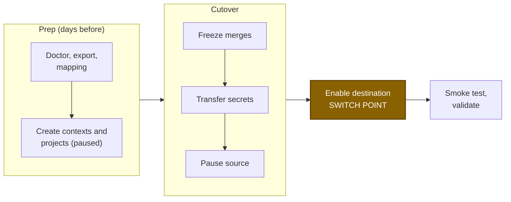

# GitHub OAuth to GitHub OAuth

Use this runbook to move one OAuth org (`gh/…` or `bb/…`) to another OAuth org: a rename, a consolidation, or a move to a new GitHub org. Do the prep ahead of time, then run the cutover inside a freeze window.

## At a glance



There is no point of no return. The source is only paused, never changed or deleted, and `cutover --undo` puts it back.

## What moves

| Moves | Needs a step | Does not move |
|---|---|---|
| Contexts, projects, project and org settings, schedules | Secret values and SSH keys (`secrets transfer`) | Group context restrictions |
| Project and expression context restrictions | Webhook secrets and URLs (new ones are generated) | SSO, build history, Insights |
| Self-hosted runner resource classes | Orbs, runner instances (see steps 11 and 12) | Per-project role grants |

The full list is in [what moves](../get-started/what-moves.md).

## Before you start

- [ ] You are an admin of both CircleCI orgs, and the destination org already exists.
- [ ] Two personal API tokens (User Settings > Personal API Tokens), one per org.
- [ ] The CLI is installed ([install](../get-started/install.md)). `circleci-migrate version` prints v0.19.0 or later.
- [ ] Every source project has a checkout key (Project Settings > SSH Keys) or a GitHub App pipeline. The transfer pipeline needs one of them.
- [ ] Repos moving to a new GitHub org: a GitHub token with `repo` read, and the secrets transfer scheduled before the repos move (step 8).
- [ ] A freeze window agreed with the team.

## Set up

```bash
export SOURCE_ORG="gh/acme"
export DEST_ORG="gh/acme-new"
export DEST_ORG_ID="<dest-org-uuid>"
export CIRCLECI_SOURCE_TOKEN="<source-org-admin-token>"
export CIRCLECI_DEST_TOKEN="<destination-org-admin-token>"
export GITHUB_TOKEN="<github-pat-with-repo-read>"   # only if repos move to a new GitHub org
```

```powershell
$SOURCE_ORG = "gh/acme"
$DEST_ORG = "gh/acme-new"
$DEST_ORG_ID = "<dest-org-uuid>"
$env:CIRCLECI_SOURCE_TOKEN = "<source-org-admin-token>"
$env:CIRCLECI_DEST_TOKEN = "<destination-org-admin-token>"
$env:GITHUB_TOKEN = "<github-pat-with-repo-read>"   # only if repos move to a new GitHub org
```

The destination org ID is under Organization Settings > Overview. Commands use `\` to continue lines. In PowerShell, end the line with a backtick instead.

> [!TIP]
> Prefer prompts? `circleci-migrate migrate` runs export, sync, secrets transfer and validation in one guided pass. This runbook is the same flow with a pause between each step.

## Steps

### Prep

#### 1. Run preflight

Catch bad tokens and unreachable orgs early. `doctor` is read-only.

```bash
circleci-migrate doctor --source-org "$SOURCE_ORG" --dest-org "$DEST_ORG"
```

Check: it exits 0 with no hard failures.

#### 2. Export the source

Export records names and structure, never secret values, and is read-only.

```bash
circleci-migrate export --source-org "$SOURCE_ORG" --output manifest.json --report migration-report.md
```

Add `--runner-namespace <namespace>` for self-hosted runners and `--orb-namespace <namespace>` for orbs. Repos that were never followed in CircleCI are missing from the export. Add `--follow-all` (needs `GITHUB_TOKEN`) to follow them first.

Check: read `migration-report.md` in full and note the counts of contexts, projects and project env vars.

#### 3. Write mapping.json

Without `org.to`, `sync` writes to your source org. The mapping prevents that.

```bash
cat > mapping.json <<EOF
{ "org": { "from": "$SOURCE_ORG", "to": "$DEST_ORG" } }
EOF
```

```powershell
@{ org = @{ from = $SOURCE_ORG; to = $DEST_ORG } } | ConvertTo-Json | Set-Content mapping.json
```

If the repos moved to a new GitHub org, also add `"github_org": { "from": "acme", "to": "acme-new" }`. See [mapping](../concepts/mapping.md).

Check: `mapping.json` has `org.to` set to the destination.

#### 4. Create the migration-secrets context

Secret values can only be read inside a pipeline. The transfer pipeline runs in the source org and gets the destination token from a context. In the source org, go to Organization Settings > Contexts and create `migration-secrets` with one variable, `CIRCLECI_DEST_TOKEN`, set to the destination token.

Check: the context exists in the source org with that one variable.

#### 5. Dry-run the sync

Without `--apply`, nothing is written. Read the plan before you apply.

```bash
circleci-migrate sync --manifest manifest.json --mapping mapping.json
```

Check: no unexpected `error` lines. `manual` lines for secret values are expected, because those move in step 8. Project counts match the report.

### Cutover

#### 6. Create the destination contexts and projects

This creates contexts, projects, settings, webhooks and schedules in the destination. OAuth projects are created paused: no webhook, no builds.

```bash
circleci-migrate sync --manifest manifest.json --mapping mapping.json \
  --apply --webhook-secrets-out webhook-secrets.json
```

Answer N at the "Enable builds" prompt. For repos in a new GitHub org, add `--dest-github-org acme-new`.

Check: re-run step 5. Every line now says `exists`.

#### 7. Match source projects to destination projects

Secret transfer routes project values by slug, and OAuth slugs need an explicit entry per project. This overwrites `mapping.json`, so re-add any `github_org` line afterwards. It needs the destination token.

```bash
circleci-migrate mapping generate --manifest manifest.json --dest-org "$DEST_ORG" --output mapping.json
```

Check: the report lists each source project under `matched`, with none `unmatched`.

#### 8. Freeze merges, then transfer the secrets

Freeze merges in the source repos so the values you copy are the final ones. The transfer runs one pipeline per source project and writes each value straight to the destination over TLS. Nothing touches disk. If your repos move to a new GitHub org, run it before they move, because the pipelines check out code from the old org.

```bash
circleci-migrate secrets transfer --manifest manifest.json --mapping mapping.json \
  --dest-org-id "$DEST_ORG_ID" --dest-token-context migration-secrets \
  --include-project-vars --include-ssh-keys --remove-restrictions --enable-trigger
circleci-migrate secrets transfer --manifest manifest.json --mapping mapping.json \
  --dest-org-id "$DEST_ORG_ID" --dest-token-context migration-secrets \
  --include-project-vars --include-ssh-keys --remove-restrictions --enable-trigger --apply
```

Check: the dry run lists no `SKIP`. The apply reports every pipeline succeeded. See [secrets](../concepts/secrets.md).

#### 9. Pause the source

Pausing stops new builds in the source so both orgs never build the same push. Every change is recorded in `cutover-state.json`, so you can undo it.

```bash
circleci-migrate cutover --manifest manifest.json --mapping mapping.json --pause-source
circleci-migrate cutover --manifest manifest.json --mapping mapping.json --pause-source --apply
```

Add `--pause-org` to pause the whole source org. Keep `cutover-state.json` until you confirm the cutover.

Check: every source project is listed as paused. See [cutover](../concepts/cutover.md).

#### 10. Enable the destination

Following each project installs the GitHub webhook and deploy key, so pushes start building in the destination. `--yes` skips the confirmation prompt. `cutover --enable-dest` does nothing for an OAuth destination, which is why the source is paused with `cutover --pause-source` in the step before.

```bash
circleci-migrate sync --manifest manifest.json --mapping mapping.json --apply --yes
```

Check: the destination Projects page shows every project as followed.

#### 11. Move orbs (only if you publish orbs)

A namespace belongs to one org. Ask CircleCI support to move a same-name namespace, and orb references need no change. To publish under a different namespace instead, run:

```bash
circleci-migrate sync --manifest manifest.json --mapping mapping.json \
  --only orb --dest-orb-namespace <new-namespace> --apply
```

Check: the orbs are listed by `validate` (see Verify). If you used a new namespace, rewrite the orb references in your configs.

#### 12. Recreate runners (only if you use them)

Resource classes are recreated, but runner instances never move. Register agents with new tokens.

```bash
circleci-migrate sync --manifest manifest.json --mapping mapping.json \
  --only runner --dest-runner-namespace <namespace> --apply
```

Check: runners register against the destination classes and show online.

## Verify

Push a commit to a migrated repo. Check: a pipeline starts in the destination org, runs green, and a job can read a context variable.

```bash
circleci-migrate validate --source-org "$SOURCE_ORG" --dest-org "$DEST_ORG" \
  --mapping mapping.json --dest-token-context migration-secrets
```

A clean report exits 0 and lists only expected `manual` items: group context restrictions, SSO and role bindings. Add `--dest-runner-namespace` and `--dest-orb-namespace` to compare runners and orbs.

Then clean up:

- [ ] Give each webhook sender and receiver its new value from `webhook-secrets.json`, then delete the file.
- [ ] Recreate group context restrictions in the destination UI.
- [ ] Rotate every transferred secret. Rotate the destination token and delete the `migration-secrets` context.
- [ ] If the source had `drop_all_build_requests` or `require_context_group_restriction` on, set them now with `sync --include-danger-flags --apply`.
- [ ] Update badges, Slack apps and required status checks to the new org.

## Roll back

Undo restores the source flags and re-enables the source triggers it disabled.

```bash
circleci-migrate cutover --manifest manifest.json --mapping mapping.json --undo --apply
```

`--undo` does not unfollow destination projects. To stop destination builds, unfollow the projects in the destination UI. The source org itself is never deleted or altered beyond the pause.

## If something fails

| Error | Fix |
|---|---|
| `the project has no SSH key` | The source project has no checkout key or GitHub App pipeline. Add a deploy key in Project Settings > SSH Keys and re-run step 8. |
| `source project(s) are paused` | Run the transfer before the pause, or run `cutover --undo --apply` and retry. |
| `SKIP` for a project in the transfer plan | No destination project matches. Re-run steps 6 and 7. |
| `sync` wrote to the source org | `mapping.json` has no `org.to`. Fix it and re-run. |
| No pipeline after the push | Confirm the project is followed and the GitHub webhook is installed. |
| `validate` shows the `migration-secrets` context missing | Pass `--dest-token-context migration-secrets`. |

More in [troubleshooting](../reference/troubleshooting.md). Flags: [`sync`](../cli/circleci-migrate_sync.md), [`secrets transfer`](../cli/circleci-migrate_secrets_transfer.md), [`cutover`](../cli/circleci-migrate_cutover.md).
