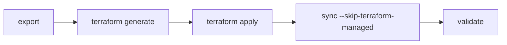

# Terraform output

`terraform generate` turns an exported manifest into Terraform files for the official `CircleCI-Public/circleci` provider (`~> 0.3`). Use it when the destination org should end up in Terraform state. For a one-shot migration, `sync` is simpler.

Terraform manages the resource shells: contexts, projects, variables, webhooks, runner classes, and pipelines and triggers. The CLI still handles everything the provider cannot. The generated `GAPS.md` lists each remaining step with its exact command.



## Generate

```bash
circleci-migrate terraform generate \
  --manifest manifest.json \
  --dest-org-id "$DEST_ORG_ID" \
  --out ./terraform/
```

Check: `./terraform/` holds `versions.tf`, `providers.tf`, `contexts.tf`, `projects.tf`, `migration.auto.tfvars.json` and `GAPS.md`.

Other files appear when they apply: `restrictions.tf`, `webhooks.tf`, `runners.tf`, `pipelines.tf` (GitHub App and standalone destinations only), `secrets.auto.tfvars.json` and `imports.tf`.

## Pick the destination type

The provider supports advanced project settings only on GitHub App and standalone orgs. On a GitHub OAuth org they would make `terraform apply` fail.

| `--dest-org-type` | Aliases | Use for |
|---|---|---|
| `oauth` | `gh`, `github` | `gh/<org>` destination. Advanced settings, pipelines and triggers are left to `sync`. |
| `standalone` | `app`, `github_app` | `circleci/<id>` destination. Everything is included. |

If you omit it, the type is inferred from the source slug in the manifest, and a note prints which type was assumed.

## Secret values

The manifest has no secret values. Choose one:

```bash
# Plaintext values from a captured bundle, written to secrets.auto.tfvars.json
circleci-migrate terraform generate --manifest manifest.json --secrets secrets.json \
  --dest-org-id "$DEST_ORG_ID" --out ./terraform/

# REPLACE_ME values plus a SECRETS_WORKBOOK.md to fill in
circleci-migrate terraform generate --manifest manifest.json --placeholders \
  --dest-org-id "$DEST_ORG_ID" --out ./terraform/
```

> [!WARNING]
> `--secrets` writes plaintext. Treat `secrets.auto.tfvars.json` like a password file and delete it after `terraform apply`.

## Apply, then fill the gaps

```bash
cd ./terraform/
export TF_VAR_circleci_api_token="<destination-org-admin-token>"
terraform init && terraform plan && terraform apply
cd ..
circleci-migrate sync --manifest manifest.json --mapping mapping.json --apply --skip-terraform-managed
```

Check: `terraform plan` shows the resource counts you expect, and a second `plan` shows no changes.

`--skip-terraform-managed` skips contexts, projects and runner classes, which Terraform now owns. To choose sections yourself, use `--only` with `org-settings`, `ciam`, `extras`, `contexts`, `projects`, `runner` or `orb`. The two flags are mutually exclusive.

## Adopt resources `sync` already created

Capture their IDs with `sync --json`, then emit Terraform `import` blocks (Terraform 1.5 or later) into `imports.tf`:

```bash
circleci-migrate sync --manifest manifest.json --mapping mapping.json --json > sync-result.json
circleci-migrate terraform generate --manifest manifest.json --dest-org-id "$DEST_ORG_ID" \
  --import-existing --existing sync-result.json --out ./terraform/
```

## Other options

- `--mapping mapping.json` remaps org slugs and project IDs, the same file `sync` uses.
- `--dest-runner-namespace` maps runner classes to a different namespace. By default the source namespace is kept.
- `--host` sets the provider host for CircleCI Server.

## What Terraform does not manage

These always need `sync` and appear in `GAPS.md`: legacy schedules, checkout and deploy keys, additional SSH keys, project API tokens, roles and groups, org settings (feature flags, OIDC, OTel, contacts, retention, budgets, orb allow list, SSO, release tracker), and private orb inlining.

For an OAuth destination, project advanced settings and pipeline and trigger resources also go to `sync`.
